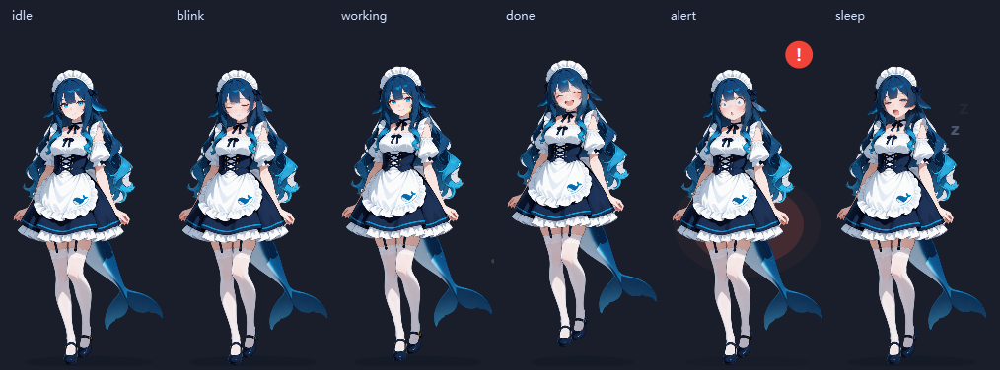
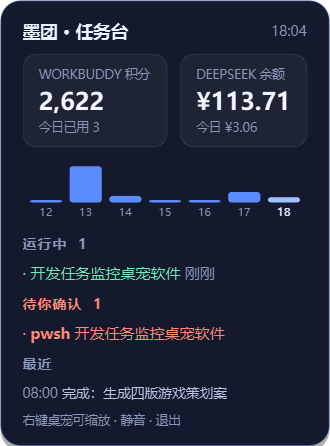
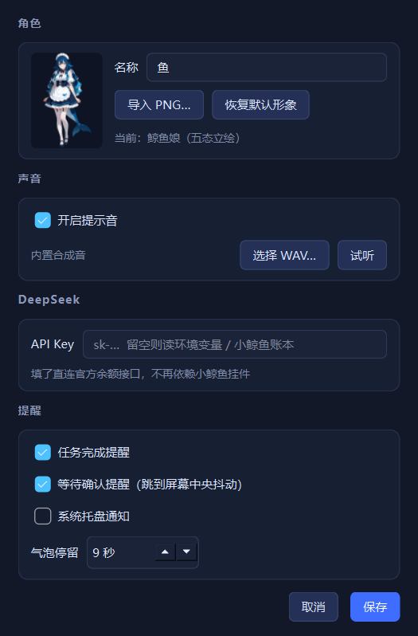
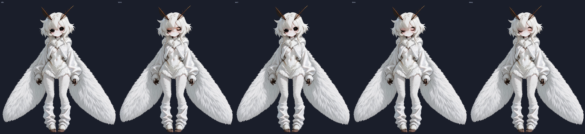

# WorkBuddy Desk Pet

A transparent always-on-top desktop pet for **WorkBuddy / DeepSeek Harness (DSH)**. It watches your agent sessions, jumps when a task finishes, shakes in the middle of your screen when something is waiting for your approval, and keeps your credit balance one click away.



English | [简体中文](README.zh-CN.md)

## Features

| | |
|---|---|
| **Task watch** | Reads `workbuddy.db` and DSH session event streams. Session `working → completed` and turn-end both raise a notification |
| **Approval alerts** | Catches `approval/asked` events → pet flies to the centre of the screen, shakes, shows the tool name and the reason. Stays until you handle it or click the pet |
| **Credits** | Remaining credits from the official billing endpoint, plus today's spend measured as the drop in the server-side balance |
| **DeepSeek balance** | Fetches `/user/balance` directly with your own API key — **no DSH plugin required**. Today's spend is derived from balance drops |
| **Info panel** | Left click: credits, balance, running tasks, DSH sessions, pending approvals, recent history |
| **Five-state skin** | idle breathing + random blink, working hop, done jump with confetti, alert shake, sleepy |
| **Multiple characters** | Right click → 角色 to switch; drop a folder under `assets/` to add your own |
| **Settings** | Right click → Settings: rename, import a PNG, custom WAV, toggle each alert channel, bubble duration |
| **Plugin mode** | Ships as a DSH plugin: starts with the host, dies with the host |

| Panel | Settings |
|---|---|
|  |  |

## Requirements

- **Windows 10/11** (uses `winsound`, `winreg`, `msvcrt`)
- **Python 3.10+** (tested on 3.13)
- `pip install -r requirements.txt` → PySide6-Essentials, zstandard, cryptography

Optional, each one degrades gracefully:

| Optional | Without it |
|---|---|
| WorkBuddy desktop app | No task list / no credits |
| DSH session folder (`~/.dsh/sessions`) | No approval alerts, no DSH section in the panel |
| Whale widget (`dsh-whale-widget`) | Nothing — it is only an optional fallback for the DeepSeek balance |
| ComfyUI | Only affects regenerating art, zero runtime dependency |

DeepSeek balance does **not** depend on any plugin. Set the API key once (right click → Settings → DeepSeek, or the `DEEPSEEK_API_KEY` environment variable) and the pet talks to `api.deepseek.com` itself. If no key is configured, it degrades to reading the whale-widget ledger — which is why that row is still listed.

## Quick start

```bat
git clone https://github.com/CS8812279/workbuddy-deskpet.git
cd workbuddy-deskpet
pip install -r requirements.txt
python main.py
```

Or double-click `启动桌宠.bat` (runs `pythonw`, no console window). For troubleshooting use `调试启动.bat`.

Useful flags:

```bat
python main.py --check      :: print what each data source returns, no window
python main.py --selftest   :: render every state to assets/preview
python main.py --demo       :: fire a fake approval alert and screenshot it
```

## Run as a DSH plugin (auto start / stop)

```bat
python tools/plugin_install.py            :: install (idempotent)
python tools/plugin_install.py --off      :: uninstall
python tools/plugin_install.py --status   :: show current state
```

What it does:

1. Copies `plugin/` into `~/.dsh/profiles/desktop/node_modules/dsh-deskpet` and writes `deskpet.json` (project path + interpreter path).
2. Appends a **marked block** to `~/.dsh/profiles/desktop/cordis.patch.yml`:

   ```yaml
   - insert:
       - id: dsh-deskpet
         name: dsh-deskpet
   ```

3. Backs up the patch file, validates the YAML, and test-loads the plugin with `node`. Any failure rolls the file back automatically.

Lifecycle:

- DSH starts → plugin `apply()` spawns `pythonw main.py --parent-pid <DSH pid>`
- DSH exits → plugin `dispose()` kills the child
- DSH is force-killed → the `--parent-pid` watchdog notices within 2 s and exits

> Restart DSH for the patch layer to take effect. Don't launch the pet manually while plugin mode is on, and keep the tray menu's "start with Windows" off — both would fight over the single-instance lock.

## Configuration

`config.json` is created on first run:

```json
{
  "pet":      { "scale": 1.0, "x": null, "y": null, "always_on_top": true,
                "muted": false, "name": "墨团", "skin": "auto", "skin_file": "" },
  "alerts":   { "complete": true, "approval": true, "sound": true, "tray": true,
                "center_on_alert": true, "bubble_seconds": 9, "sound_file": "" },
  "monitor":  { "interval_ms": 2000, "lookback_minutes": 30 },
  "deepseek": { "refresh_seconds": 60, "api_key": "" },
  "credits":  { "refresh_seconds": 300, "exe": "" },
  "autostart": false
}
```

- `pet.skin`: `auto` uses `assets/whale-girl/frames/`, `blob` falls back to the procedural blob.
- `deepseek.api_key`: `sk-…`. Leave empty to fall back to the `DEEPSEEK_API_KEY` environment variable, then to the whale-widget ledger.
- `credits.exe`: leave empty to auto-detect `WorkBuddy.exe` (`%LOCALAPPDATA%\Programs\WorkBuddy` → uninstall registry).
- Size / mute / always-on-top / position are also editable from the tray and right-click menu and are saved immediately.

## Data sources and privacy

Everything is read locally, nothing is uploaded.

| Source | What is read |
|---|---|
| `%USERPROFILE%\.workbuddy\workbuddy.db` | `sessions` (status, title, cwd), `session_usage` (per-request credits) — opened read-only with WAL |
| `%USERPROFILE%\.dsh\sessions\**\session.v4.jsonl.zstd` | zstd multi-frame JSONL, read incrementally by byte offset: `approval/asked`, `approval/decided`, `turn/end`, `session/title` |
| `%USERPROFILE%\.dsh\.dshw-usage.json` | Whale-widget ledger — **optional fallback** for the DeepSeek balance |
| `api.deepseek.com/user/balance` | DeepSeek balance, called with your own API key |

### DeepSeek balance

Provider chain, first hit wins:

1. API key from Settings (`deepseek.api_key`)
2. `DEEPSEEK_API_KEY` environment variable
3. `~/.dsh/.credentials.yaml` → `refs.DEEPSEEK_API_KEY` (only if it looks like `sk-…`; DSH usually stores an internal handle there)
4. Whale-widget ledger `.dshw-usage.json` (legacy fallback, not required)

Today's spend is accumulated from the drop in `total_balance` between polls — a top-up never cancels what you already burned. On the first poll of a day the baseline is seeded from the widget ledger's history when available, so the number does not restart from zero after an upgrade.
| `%LOCALAPPDATA%\CodeBuddyExtension\...\workbuddy-desktop.info` + `www.codebuddy.cn` | remaining credits |

### How the credit balance is obtained

Same chain as `dsh-workbuddy-connect`, reimplemented:

1. Run `WorkBuddy.exe` with `ELECTRON_RUN_AS_NODE=1` and a one-liner that returns `atRestSecretKey`.
2. `sha256(secret)` → AES-256-GCM key; open the `$wbEncrypted` envelope around `accessToken`.
3. `POST /v2/billing/meter/get-user-resource` with a Bearer token, sum `CycleCapacityRemain` over packages that have not expired.

Quirks worth knowing:

- The query window must be **long** (a year). A 37-day window silently drops annual packages — measured 2622 vs 5277 credits.
- The mask returned by ComfyUI's `RemoveBackground` is inverted; native `InvertMask` is required (see `tools/build_skin.py`).
- Both endpoints are **undocumented**. They can break after a client update.

## Character and skin

Two skins ship in the box: **鲸鱼娘** (`whale-girl`, the default) and **雪蛾** (`moth-girl`, pure-black insect eyes).



The whale girl skin is a derivative of the community character **鲸鱼娘 / whale girl** ([TreapGoGo/deepseek-whale-girl](https://github.com/TreapGoGo/deepseek-whale-girl)), generated locally with ComfyUI + Krea 2.

```
assets/whale-girl/frames/
  idle.png  blink.png  alert.png  done.png  sleep.png   # same size, bottom-aligned
```

Expressions are made with **masked inpainting** (`SetLatentNoiseMask` over the face oval), so every pixel outside the mask is identical to the base image — switching frames can never shift the body.

To use your own art: right click → Settings → import a PNG (single image for all states), or drop five same-size PNGs into `frames/`.

Adding a new character (needs ComfyUI on `127.0.0.1:8188`):

```bat
python tools/make_skin.py --name moth-girl --image D:/art/base.png ^
    --box 822,345,1064,426 --display "雪蛾" --feather 9
```

`--box` is the **eye band** (x1,y1,x2,y2), not the whole face. Lessons learned the hard way:

- Masking the entire face lets the model repaint the irises — a pure-black insect eye turns brown in one pass. A narrow eye band keeps the rest pixel-identical.
- Closed eyes need `denoise 0.85`; open-eye expressions need `≤0.55` or the colour drifts.
- "Open mouth" prompts on a chibi face produce a black-red hole. Keep lips closed.
- `alert` reuses the idle frame on purpose: the base face already reads as startled, and the red badge + shake + rings carry the signal.

## Project layout

```
main.py              entry point (--check / --selftest / --demo / --parent-pid)
app.py               orchestration: poller → state machine → window / bubble / tray / panel
plugin/              DSH plugin package (host lifecycle)
core/                config, ledger, parent watchdog
monitor/             workbuddy.py · dsh.py · deepseek.py · credits.py
ui/                  pet window, sprite skin, bubble, panel, settings, sound, icons
tools/               skin generation, plugin install, smoke tests
tests/               offline tests for parsers and state machine
```

## Tests

```bat
python tests/test_monitors.py      :: zstd incremental read, approval parsing, session transitions, credit deltas
node tools/plugin_smoke.mjs        :: plugin spawns and reaps the pet
python tools/guard_smoke.py        :: watchdog kills the pet when the host dies
```

## Upstream and licenses

- **Code:** MIT — see [LICENSE](LICENSE)
- **Character art (`assets/whale-girl/`, `docs/*.png`):** CC BY-SA 4.0, derived from the community whale girl design — see [NOTICE.md](NOTICE.md)
- **Upstream projects:** `deepseek-whale-girl`, `dsh-workbuddy-connect`, ComfyUI, Krea 2, PySide6, zstandard, cryptography — full table with URLs and licenses in [NOTICE.md](NOTICE.md)

## Disclaimer

Unofficial hobby project. Not affiliated with, endorsed by, or supported by Tencent, WorkBuddy, DeepSeek or Krea. It reads a local app's credential file and calls an undocumented billing endpoint on your behalf — that is your own account and your own risk. Everything runs locally; there is no telemetry.
